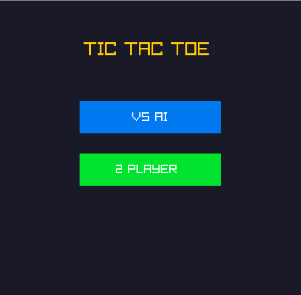
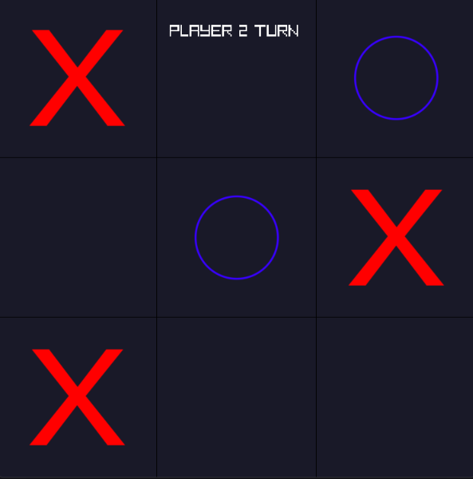

# Tic Tac Toe AI

<div align="center">

  <h3>A Classic Tic Tac Toe Game with Minimax AI</h3>

  <p>
    A simple Tic Tac Toe game built with C++ and Raylib,
    featuring two-player mode and an AI opponent powered by the Minimax algorithm.
  </p>

  <p>
    
    
    
    
  </p>

</div>

---

## Overview

**Tic Tac Toe AI** is a classic 3×3 Tic Tac Toe game developed using C++ and Raylib.

The game provides two playable modes: Player vs AI and Player vs Player. In AI mode, the computer uses the **Minimax algorithm** to evaluate possible moves and select the best available move.

The project was built to explore game development fundamentals, graphical rendering, game state management, and basic artificial intelligence.

## Game Preview

<div align="center">

  

  <p><b>Main Menu</b></p>
  <p><i>Select between Player vs AI and Two Player modes.</i></p>

</div>

## Gameplay Screenshots

<div align="center">
  <table>
    <tr>
      <td align="center">
        
        <br><b> Play With Friends </b>
      </td>
    </tr>
  </table>
</div>

## Features

- **Player vs AI:** Play against a computer-controlled opponent.
- **Two Player Mode:** Play locally with another player.
- **Minimax AI:** Evaluates possible game outcomes to select the best move.
- **Win Detection:** Detects horizontal, vertical, and diagonal winning combinations.
- **Draw Detection:** Detects when the board is full without a winner.
- **Interactive Board:** Place X and O symbols using mouse input.
- **Sound Effects:** Includes sound effects for placing symbols and ending a game.
- **Game State Management:** Separates the menu, gameplay, and game-over screens.

## Game Modes

| Mode | Description |
|---|---|
| VS AI | Player 1 competes against the Minimax AI. |
| 2 Player | Two players compete on the same computer. |

## Controls

| Input | Action |
|---|---|
| Left Mouse Button | Select a menu option or place a symbol |
| MENU Button | Return to the main menu |

## AI Implementation

The AI opponent uses the **Minimax algorithm**, a recursive decision-making algorithm commonly used in turn-based games.

It evaluates possible moves by simulating future game states:

- `+10` — AI wins.
- `-10` — Player wins.
- `0` — Draw.

The algorithm explores available board positions and alternates between maximizing the AI's score and minimizing the player's score.

This allows the AI to select the best available move based on the current board state.

## Game State Management

The game uses an enumeration to manage its main states:

| State | Description |
|---|---|
| `MENU` | Displays the main menu and game mode selection. |
| `PLAYING` | Handles player input, AI moves, and board rendering. |
| `GAMEOVER` | Displays the game result and menu option. |

The game also uses a separate `Mode` enumeration to distinguish between `VS_AI` and `VS_PLAYER`.

## Technical Details

| Component | Implementation |
|---|---|
| Programming Language | C++ |
| Graphics Library | Raylib |
| Board Size | 3 × 3 |
| AI Algorithm | Minimax |
| Input | Mouse |
| Audio | Raylib Audio |
| Target Frame Rate | 60 FPS |

## Requirements

- C++ Compiler
- Raylib
- Raylib audio support
- Compatible development environment

## Getting Started

1. Clone this repository:

   ```bash
   git clone https://github.com/YOUR_USERNAME/YOUR_REPOSITORY.git
   ```

2. Navigate to the project directory:

   ```bash
   cd YOUR_REPOSITORY
   ```

3. Make sure Raylib is installed and configured.

4. Place the required assets in the project directory:

   ```text
   X.png
   O.png
   Place.mp3
   Winner.mp3
   GameOver.mp3
   ```

5. Compile and run the project using your configured Raylib environment.

> **Note:** Compilation commands depend on your operating system and Raylib installation.

## Project Structure

```text
TicTacToeAI/
├── assets/
│   ├── X.png
│   ├── O.png
│   ├── Place.mp3
│   ├── GameOver.mp3
│   ├── Winner.mp3
│   └── screenshots/
│       ├── home.png
│       └── Playing.png
├── TicTacToe.cpp
├── README.md
└── LICENSE
```

## License

This project is licensed under the MIT License. See the [LICENSE](LICENSE) file for details.

---

<div align="center">
  <p>Built with C++ and Raylib.</p>
</div>